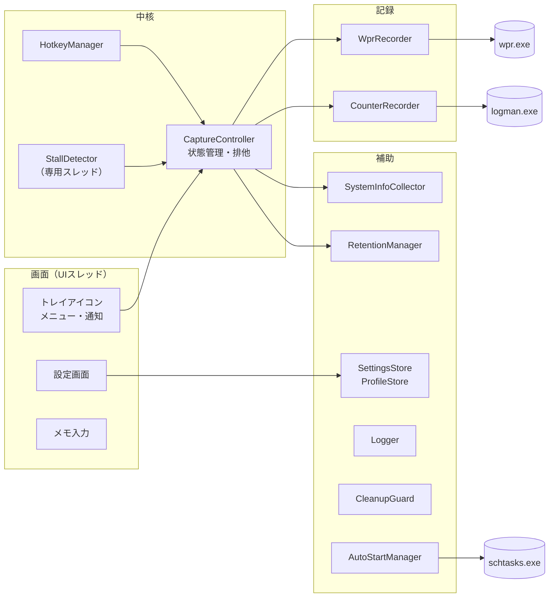
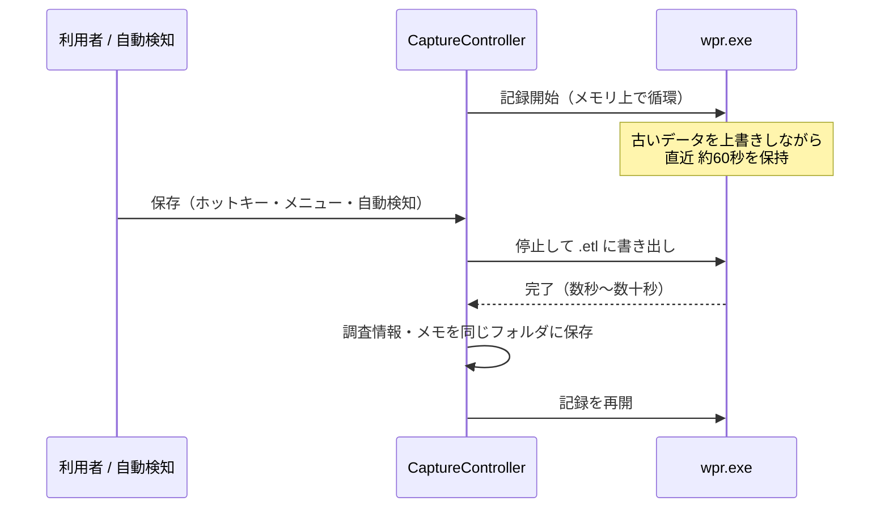
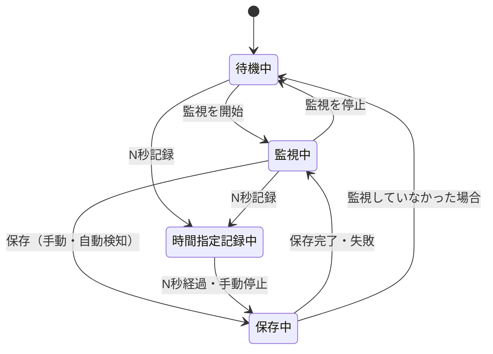

# PerfSnap 基本設計書（ドラフト v0.1）

- 作成日：2026-11-23
- 前提文書：[01-requirements.md](01-requirements.md)（v1.0）
- 状態：**レビュー待ち**

---

## 1. 設計方針

| # | 方針 | 対応する要件 |
|---|---|---|
| P1 | **待機中は何もしない**。定期的に動くのは自動検知のごく軽い処理だけにする | N-01, N-02 |
| P2 | 記録の本体は Windows 標準の `wpr.exe`・`logman.exe` に任せ、ツールは**起動・停止・保存の指示役**に徹する | §2.1, N-03 |
| P3 | ツールが落ちても、記録が残り続けない仕組みを起動時と終了時の両方に持つ | F-32, N-10 |
| P4 | 保存データは、そのまま既存の分析ツールで開ける形式にする | G4, F-22 |
| P5 | 外部と通信しない。ファイルを消すのは自分の出力フォルダ内に限る | N-20, N-21 |

---

## 2. 全体構成

### 2.1 構成図



### 2.2 コンポーネント一覧

| コンポーネント | 役割 |
|---|---|
| TrayApp | トレイアイコン、右クリックメニュー、通知（F-01〜F-03, F-05） |
| HotkeyManager | グローバルホットキーの登録と受信（F-04） |
| CaptureController | 記録の開始・停止・保存の司令塔。状態を一元管理し、同時実行を防ぐ |
| WprRecorder | `wpr.exe` の操作（ETW トレース。F-10, F-11） |
| CounterRecorder | `logman.exe` の操作（パフォーマンスカウンター。F-12） |
| StallDetector | 遅延の自動検知（F-15） |
| SettingsStore / ProfileStore | 設定とプロファイルの読み書き（F-13, F-30） |
| RetentionManager | 出力フォルダの容量管理（F-21） |
| SystemInfoCollector | 保存時の調査情報の収集（F-23） |
| CleanupGuard | 起動時・終了時の後片付け（F-32） |
| AutoStartManager | ログオン時の自動起動の登録・解除（F-06） |
| Logger | ツール自身のログ（F-31） |

---

## 3. 記録の方式

### 3.1 2 種類の記録

| | ETW トレース（wpr） | パフォーマンスカウンター（logman） |
|---|---|---|
| 目的 | 事象が**なぜ**起きたか（どのプロセス・ドライバーが何をしていたか） | 事象が**いつ**起きたか |
| 細かさ | 非常に細かい | 粗い（15 秒間隔） |
| 記録時間 | 直近 約 60 秒（メモリ上で循環） | 長時間（ファイル上で循環） |
| 出力 | `.etl` → Windows Performance Analyzer で開く | `.blg` → パフォーマンスモニターで開く |

### 3.2 フライトレコーダー方式（F-10）



- **書き出し中から再開までの数秒〜数十秒は記録が途切れる。** この間に再び保存が指示されても受け付けない（通知で知らせる）。
- `wpr` には別名（インスタンス名 `PerfSnap`）を付けて起動し、他の人が手作業で使う `wpr` とぶつからないようにする。※ 対応バージョンの確認は詳細設計で行う。

### 3.3 時間指定の記録（F-11）

- フライトレコーダーが動いていれば、いったん止めてから、ファイルに直接書く方式で N 秒間記録する。終わったらフライトレコーダーを再開する。
- N は 30 / 60 / 120 / 300 秒からメニューで選ぶ。

### 3.4 初期プロファイル

| プロファイル | 方式 | wpr の組み込みプロファイル / カウンター | 用途 |
|---|---|---|---|
| 軽量監視 | logman | 下表のカウンター、15 秒間隔、上限 512 MB で循環 | 常時オン |
| 入力遅延の調査（既定） | wpr | `CPU` + `DiskIO` + `Minifilter` + `DesktopComposition` | フライトレコーダー |
| 詳細 | wpr | 上記 + `FileIO` + `Registry` | 担当者が短時間だけ使う |

- `Minifilter`：セキュリティ製品のファイル検査にかかった時間を見るため
- `DesktopComposition`：画面の更新が遅れる症状を見るため
- 上記の wpr プロファイルはすべて、この PC の `wpr -profiles` に存在することを確認済み

**軽量監視のカウンター**

| カウンター | 見たいこと |
|---|---|
| `\Processor(_Total)\% Processor Time` | CPU 全体の使用率 |
| `\Processor(_Total)\% DPC Time`、`% Interrupt Time` | ドライバーの処理で CPU が占有されていないか |
| `\System\Processor Queue Length` | CPU 待ちの行列 |
| `\Memory\Available MBytes`、`Pages/sec` | メモリ不足・ページング |
| `\PhysicalDisk(_Total)\% Idle Time`、`Avg. Disk Queue Length` | ディスクの混雑 |
| `\Process(*)\% Processor Time`、`IO Data Bytes/sec`、`Working Set` | どのプロセスが原因か |

---

## 4. 状態の設計

### 4.1 状態遷移



- 「監視中」＝フライトレコーダーが動いている状態
- 軽量監視（logman）は上の状態とは**独立**してオン・オフできる

### 4.2 アイコン（F-02）

| 状態 | アイコン | ツールチップ |
|---|---|---|
| 待機中 | 灰色 | PerfSnap：待機中 |
| 監視中 | 緑 | PerfSnap：監視中（直近 60 秒を保持） |
| 時間指定記録中 | 赤 | PerfSnap：記録中（残り N 秒） |
| 保存中 | 黄 | PerfSnap：保存中 |

色だけに頼らないよう、形も変える（例：待機中は丸、監視中は波形、記録中は点、保存中は矢印）。

---

## 5. 遅延の自動検知（F-15）

### 5.1 2 つの検知方法

| 検知方法 | しくみ | 何が分かるか |
|---|---|---|
| A. システム停止の検知 | 専用スレッドが 0.5 秒眠って起きることを繰り返す。起きるのが予定より大きく遅れたら（既定：1.5 秒以上）、PC 全体が詰まったとみなす | CPU の取り合い、ドライバーによる占有など、PC 全体の詰まり |
| B. 前面アプリの応答なし検知 | 1 秒ごとに、前面のウィンドウに応答確認を送る（Windows 標準の方法。最大 2 秒待つ） | 操作中のアプリが固まったこと |

- どちらも 1 秒に 1〜2 回目覚めるだけなので、CPU への影響はほぼない（N-01）。
- B は前面のアプリ自体の不具合でも反応する。誤検知を減らすため、A と B のどちらを使うかを設定で選べるようにする（既定：両方オン）。

### 5.2 自動保存の歯止め

| 項目 | 既定値 | 目的 |
|---|---|---|
| 検知後の待ち時間 | 5 秒 | 事象の最中ではなく、少し後に保存して事象の全体を残す |
| 次の自動保存までの間隔 | 10 分 | 同じ事象で何度も保存しない |
| 1 日の自動保存の上限 | 20 回 | ディスクの使い過ぎを防ぐ |

- 自動検知が「監視中」以外の状態で起きた場合は、時刻と遅れの大きさをログに残すだけにする。

---

## 6. 画面の設計

### 6.1 右クリックメニュー

```
PerfSnap（監視中）
──────────────
今すぐ保存                 Ctrl+Alt+Shift+P
時間を指定して記録      ▶  30秒 / 60秒 / 120秒 / 300秒
──────────────
監視（フライトレコーダー）  ✓
軽量監視（カウンター）      ✓
自動検知                   ✓
プロファイル            ▶  ● 入力遅延の調査 / ○ 詳細
──────────────
保存フォルダを開く
設定...
──────────────
終了
```

- トレイアイコンの**ダブルクリック**＝「今すぐ保存」

### 6.2 設定画面（タブ構成）

| タブ | 内容 |
|---|---|
| 全般 | ログオン時の自動起動、起動時に監視を始めるか、通知のオン・オフ |
| ホットキー | 「今すぐ保存」のキー |
| 記録 | 既定のプロファイル、フライトレコーダーの保持時間、軽量監視の間隔 |
| 自動検知 | 検知方法 A/B のオン・オフ、しきい値、5.2 の歯止めの値 |
| 保存 | 保存先フォルダ、容量の上限、最低限残す空き容量 |

### 6.3 メモ入力（F-14）

- 保存が始まると、小さな入力欄を画面の右下に出す。**保存は入力を待たずに進める**（入力のせいで保存が遅れないように）。
- 30 秒入力がなければ自動で閉じる。自動検知による保存のときは出さない（設定で変更可）。

---

## 7. データの設計

### 7.1 保存フォルダの構成

```
<保存先>\
├── 20261123_143015_manual\       ← 日時_きっかけ（manual / hotkey / auto / timed）
│   ├── trace.etl                  ← ETW トレース
│   ├── sysinfo.txt                ← PC 名、OS ビルド、CPU・メモリ、プロセス一覧
│   ├── memo.txt                   ← 入力されたメモ（ある場合）
│   └── meta.json                  ← きっかけ、プロファイル、検知した遅れの大きさ など
├── counters\
│   └── PerfSnap_Light.blg         ← 軽量監視（循環して上書き）
└── perfsnap.log                   ← ツール自身のログ
```

### 7.2 ファイルの置き場所

| もの | 既定の場所 | 理由 |
|---|---|---|
| 実行ファイル | 任意（例：`C:\Tools\PerfSnap\`） | インストール不要（N-30） |
| 設定・プロファイル | `%APPDATA%\PerfSnap\settings.json` | 利用者ごとの設定 |
| 保存データ | `%LOCALAPPDATA%\PerfSnap\captures\` | 大きなファイルをローミング・同期の対象外にする |

- OneDrive の同期フォルダは既定にしない（大きなファイルの同期で負荷が増えるため）。

### 7.3 容量の管理（F-21）

- 保存の前後に、保存先の合計サイズを確認する。
- 上限（既定 10 GB）を超えたら、**`meta.json` があるフォルダ（＝自分が作ったもの）だけ**を古い順に消す（N-21）。
- ドライブの空きが 5 GB 未満なら保存しない（通知で知らせる）。

---

## 8. 権限・起動・終了

### 8.1 管理者権限

- exe に「管理者として実行する」指定（マニフェスト）を入れる。手動で起動すると UAC の確認が出る。
- 多重起動は防ぐ（2 つ目を起動したら、1 つ目のメニューを開いて終了する）。

### 8.2 ログオン時の自動起動（F-06）

- Windows の**タスク スケジューラ**に「ログオン時に、最上位の特権で実行」するタスクを登録する（`schtasks.exe` を使用）。これで毎回 UAC の確認を出さずに起動できる。
- 設定画面のチェックで登録・解除する。

### 8.3 後片付け（F-32）

| タイミング | 処理 |
|---|---|
| 起動時 | 前回の異常終了で `PerfSnap` 名の wpr・logman の記録が残っていれば止める |
| 終了時 | 動いている記録をすべて止める。軽量監視の設定は残すかどうかを設定で選べる |
| Windows のシャットダウン・ログオフ時 | 終了時と同じ処理を行う |

---

## 9. 性能の設計（N-01〜N-04）

| 工夫 | 効果 |
|---|---|
| 定期処理は自動検知の 2 つだけ。画面の再描画やポーリングはしない | 待機中の CPU をほぼゼロに |
| WinForms を採用（WPF より軽い） | メモリ・起動時間を抑える |
| 外部コマンド（wpr / logman）は必要な時だけ起動する | 常駐中の負荷を増やさない |
| ガベージコレクションを省メモリ向けの設定にする | N-02 |
| 起動を速くするビルド設定（ReadyToRun）を使う | 自動起動時の負荷を抑える |

- フライトレコーダー（wpr のメモリ上の記録）自体の負荷は、ツールではなく Windows 側でかかる。**この負荷をテストで実測し、README と設定画面に明記する**（N-03）。

---

## 10. エラー処理の方針

| 事象 | 対応 |
|---|---|
| wpr / logman が開始できない（他の記録と競合など） | 通知で知らせ、ログに詳細を残す。状態は「待機中」に戻す |
| 保存に時間がかかりすぎる（既定 120 秒） | 打ち切って通知する |
| 空き容量が足りない | 保存しない。通知で知らせる |
| 設定ファイルが壊れている | 既定値で起動し、壊れたファイルは別名で残す |
| ホットキーが他のアプリと重なっている | 通知で知らせ、設定画面で変更を促す |

---

## 11. 開発・配布の構成

| 項目 | 内容 |
|---|---|
| 言語・環境 | C# / .NET 10（LTS）/ WinForms |
| プロジェクト構成 | `src/PerfSnap`（本体）、`tests/PerfSnap.Tests`（自動テスト） |
| exe の作り方 | .NET 込みの単体 exe（単一ファイル、圧縮あり）。x64 のみ |
| 配布 | GitHub（非公開リポジトリ）の Releases に exe と SHA-256 のハッシュ値を添付 |
| コード署名 | 初版はなし。導入先のセキュリティ製品に止められる場合は、導入先の管理者と相談する（要件 §6） |

---

## 12. テストの方針（概要。詳細はテスト仕様書で定める）

| 種類 | 内容 |
|---|---|
| 自動テスト | 設定の読み書き、容量管理、自動検知の判定、状態遷移（wpr / logman は模擬に置き換える） |
| 結合テスト | 管理者権限で、実際に wpr / logman を動かして保存・後片付けを確認 |
| 性能テスト | 10 分間常駐させ、ツールの CPU・メモリを測る（N-01, N-02）。フライトレコーダーの負荷も測る（N-03） |
| 異常系 | 強制終了後の再起動で記録が止まるか、ディスクが少ないとき、ホットキーの重複 |
| 手動テスト | 操作手順の確認（チェックリスト） |

---

## 13. 詳細設計で決めること

- wpr のインスタンス名指定・メモリ量の指定が、Windows 11 の各バージョンで使えるかの確認
- 保持時間「約 60 秒」をメモリ量の設定でどう実現するか（実測で決める）
- 設定ファイルの項目と既定値の一覧
- クラスの構成とスレッドの扱い
- 自動検知のしきい値の初期値の妥当性（実測で調整）

---

## 変更履歴

| 版 | 日付 | 内容 |
|---|---|---|
| 0.1 | 2026-11-23 | 初版ドラフト |
