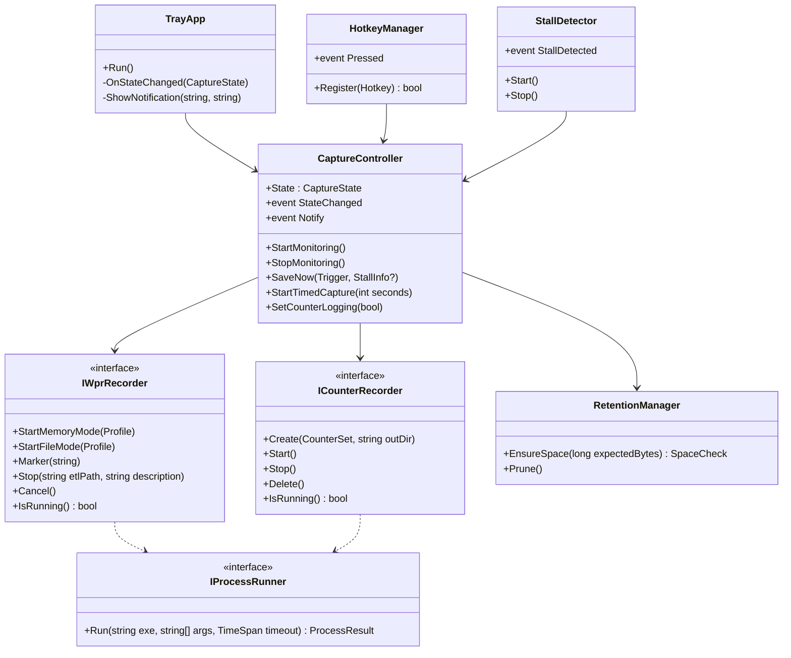

# PerfSnap 詳細設計書（ドラフト v0.1）

- 作成日：2026-11-23
- 前提文書：[01-requirements.md](01-requirements.md)（v1.0）、[02-basic-design.md](02-basic-design.md)（v0.1）
- 状態：**レビュー待ち**

---

## 1. 基本設計からの持ち越し事項の結論

| 持ち越し事項（基本設計 §13） | 結論 | 根拠 |
|---|---|---|
| wpr のインスタンス名指定 | **使える**。`-instancename PerfSnap` を全コマンドの**最後**に付ける | この PC の `wpr`（10.0.26100）のヘルプで確認。「開始時に指定したら以降のコマンドすべてに同じ指定が必要」「最後の引数にすること」と明記されている |
| 保持時間「約 60 秒」の実現方法 | 初版は**組み込みプロファイルのメモリーモードをそのまま使い、実際に何秒残るかを結合テストで実測**する。足りなければ v1.1 で独自プロファイル（.wprp）を同梱してバッファ量を指定する | 組み込みプロファイルでは保持時間を直接指定できない |
| 事象の瞬間の目印 | `wpr -marker` で、保存のきっかけ（ホットキー・自動検知）の瞬間にトレースへ目印を打つ | ヘルプで確認。WPA で目印の時刻にすぐ飛べる |
| 設定項目と既定値 | §7 で定義 | — |
| クラス構成とスレッド | §3、§4 で定義 | — |
| 自動検知のしきい値 | 初期値は基本設計のまま。結合テストで誤検知の頻度を見て調整する | — |

---

## 2. ソリューション構成

```
perf-snap\
├── PerfSnap.slnx
├── src\PerfSnap\
│   ├── PerfSnap.csproj
│   ├── app.manifest                 ← 管理者権限の要求、DPI 対応
│   ├── Program.cs                   ← 起動処理、多重起動の防止
│   ├── App\                         ← 画面（UI スレッド）
│   │   ├── TrayApp.cs
│   │   ├── TrayIcons.cs
│   │   ├── SettingsForm.cs
│   │   └── MemoForm.cs
│   ├── Core\
│   │   ├── CaptureController.cs
│   │   ├── CaptureState.cs
│   │   ├── HotkeyManager.cs
│   │   └── StallDetector.cs
│   ├── Recording\
│   │   ├── IWprRecorder.cs / WprRecorder.cs
│   │   └── ICounterRecorder.cs / CounterRecorder.cs
│   ├── Storage\
│   │   ├── Settings.cs / SettingsStore.cs
│   │   ├── Profile.cs / ProfileStore.cs
│   │   ├── CaptureFolder.cs
│   │   └── RetentionManager.cs
│   ├── Platform\                    ← Windows との境界（テストでは模擬に置き換える）
│   │   ├── IProcessRunner.cs / ProcessRunner.cs
│   │   ├── IClock.cs / SystemClock.cs
│   │   ├── NativeMethods.cs
│   │   ├── SystemInfoCollector.cs
│   │   ├── CleanupGuard.cs
│   │   └── AutoStartManager.cs
│   ├── Logging\Logger.cs
│   └── Resources\                   ← アイコン、タスク登録用 XML のひな形
└── tests\PerfSnap.Tests\
    └── PerfSnap.Tests.csproj        ← xUnit
```

### 2.1 ビルド設定（PerfSnap.csproj の要点）

| 設定 | 値 | 目的 |
|---|---|---|
| `TargetFramework` | `net10.0-windows` | .NET 10 + Windows API |
| `UseWindowsForms` | `true` | — |
| `OutputType` | `WinExe` | コンソール窓を出さない |
| `RuntimeIdentifier` | `win-x64` | — |
| `SelfContained` | `true` | .NET 込み（要件 Q2） |
| `PublishSingleFile` | `true` | 1 つの exe |
| `EnableCompressionInSingleFile` | `true` | exe を小さくする |
| `PublishReadyToRun` | `true` | 起動を速くする |
| `ServerGarbageCollector` | `false` | 省メモリ（N-02） |
| `ConcurrentGarbageCollection` | `false` | バックグラウンドの GC スレッドを持たない |
| `TieredPGO` | `true` | — |
| `InvariantGlobalization` | `false` | 日本語の表示のため |
| `Nullable` / `TreatWarningsAsErrors` | `enable` / `true` | 品質 |
| `ApplicationManifest` | `app.manifest` | `requireAdministrator` |

**配布用 exe の作成コマンド**

```powershell
dotnet publish src/PerfSnap -c Release -o publish
```

---

## 3. クラス設計

### 3.1 主なクラスと責務



### 3.2 テストのための境界

Windows に依存する部分は、すべて次のインターフェース越しに呼ぶ。自動テストでは模擬（フェイク）に差し替える。

| インターフェース | 本物 | テストでの模擬 |
|---|---|---|
| `IProcessRunner` | `wpr.exe` / `logman.exe` / `schtasks.exe` を起動 | 呼ばれた引数を記録し、決めた結果を返す |
| `IClock` | 実時間（`Stopwatch`、`DateTime.Now`） | 時刻を自由に進められる |
| `IWprRecorder` / `ICounterRecorder` | 上記の本物 | 状態だけを持つ模擬 |
| ファイル操作 | 実ディスク | 一時フォルダ |

---

## 4. スレッドの設計

| スレッド | 役割 | 起きる頻度 |
|---|---|---|
| UI スレッド | トレイ・メニュー・画面・ホットキーの受信 | 操作されたときだけ |
| 検知スレッド A | システム停止の検知（§6.1） | 0.5 秒ごと |
| 検知スレッド B | 前面アプリの応答なし検知（§6.2） | 1 秒ごと |
| 作業タスク | wpr / logman の実行、保存、容量管理 | 指示されたときだけ（スレッドプールの 1 タスク） |

- **CaptureController の処理は、すべて 1 本の作業キューで順番に実行する**（`SemaphoreSlim(1,1)`）。同時に 2 つの記録操作が走らないことを、仕組みで保証する。
- 外部コマンドの実行は UI スレッドで行わない（メニューが固まらないように）。
- 検知スレッドは、優先度を `Normal`（標準）のままにする。普通のアプリと同じ条件で遅れを測るため。
- `System.Threading.Timer` は使わず、専用スレッドの `Thread.Sleep` で待つ。タイマーはスレッドプールの混雑で遅れることがあり、遅れの原因がツール自身なのか PC なのか区別できなくなるため。

---

## 5. CaptureController の詳細

### 5.1 受け付ける操作と状態の対応表

○＝実行する、×＝受け付けない（通知で理由を出す）、—＝何もしない

| 操作 ＼ 状態 | 待機中 | 監視中 | 時間指定記録中 | 保存中 |
|---|---|---|---|---|
| 監視を開始 | ○ → 監視中 | — | × | × |
| 監視を停止 | — | ○ `wpr -cancel` → 待機中 | × | × |
| 今すぐ保存（手動） | × 「監視していません」 | ○ → 保存中 | ○ 早めに止めて保存 | × 「保存中です」 |
| 自動検知 | ログのみ | ○ → 保存中（§6.3 の歯止めを通過した場合） | ログのみ | ログのみ |
| 時間指定の記録 | ○ | ○ `wpr -cancel` してから開始 | × | × |
| 軽量監視のオン・オフ | 状態に関係なく実行できる |||

### 5.2 「今すぐ保存」の処理手順

1. 状態を「保存中」にし、アイコンを変える
2. `wpr -marker PerfSnap_<きっかけ>` で目印を打つ（失敗しても続ける）
3. 保存フォルダを作る（§8.1）。容量を確認する（§9）。足りなければ中止して監視を続ける
4. **自動検知のときは 5 秒待つ**（事象の終わりまで残すため。基本設計 §5.2）
5. `wpr -stop <保存フォルダ>\trace.etl "<説明>" -instancename PerfSnap` を実行（タイムアウト 120 秒）
6. `sysinfo.txt`、`meta.json` を書く。メモが入力されたら `memo.txt` を書く
7. 監視中だった場合は、フライトレコーダーを再開する
8. 古いデータを整理する（§9）
9. 完了を通知する（保存先・サイズ・かかった時間）

手順 5 が失敗した場合：`wpr -cancel` で後片付けしてから、監視の再開を 1 回だけ試みる。それも失敗したら「待機中」に戻して通知する。

---

## 6. 自動検知の詳細

### 6.1 検知 A：システム停止

```text
interval = 500ms
loop:
    t0 = stopwatch.Elapsed
    Sleep(interval)
    late = stopwatch.Elapsed - t0 - interval
    if late >= threshold (既定 1500ms) and late < 60s:
        raise StallDetected(kind = System, lateMs = late)
```

- `late >= 60 秒` はスリープ・休止からの復帰とみなして無視する。
- さらに、電源の状態が変わったとき（`SystemEvents.PowerModeChanged` のスリープ・復帰）の前後 10 秒は判定しない。

### 6.2 検知 B：前面アプリの応答なし

```text
loop every 1s:
    hwnd = GetForegroundWindow()
    if hwnd is null or hwnd belongs to PerfSnap: continue
    ok = SendMessageTimeout(hwnd, WM_NULL, 0, 0,
                            SMTO_ABORTIFHUNG | SMTO_BLOCK, timeout = 2000ms)
    if not ok and GetLastError() == ERROR_TIMEOUT (1460):
        raise StallDetected(kind = AppHung, process = 前面ウィンドウのプロセス名)
```

- `SMTO_ABORTIFHUNG`：Windows がすでに「応答なし」と判定しているウィンドウには待たずに失敗を返す。この場合も検知とする（`IsHungAppWindow` で確認）。
- プロセス名は `meta.json` にだけ残す。

### 6.3 自動保存の歯止め

| 判定 | 既定値 | 判定の順序 |
|---|---|---|
| 監視中であること | — | 1 |
| 前回の自動保存から | 10 分以上 | 2 |
| 今日の自動保存の回数 | 20 回未満 | 3 |

- 歯止めで止めた検知も、ログには `SKIP` として残す（何回起きていたかを後で数えられるように）。

---

## 7. 設定ファイル

### 7.1 settings.json（既定値）

場所：`%APPDATA%\PerfSnap\settings.json`

```json
{
  "schemaVersion": 1,
  "general": {
    "startMonitoringOnLaunch": true,
    "showNotifications": true,
    "stopCountersOnExit": false
  },
  "hotkey": { "modifiers": ["Ctrl", "Alt", "Shift"], "key": "P" },
  "recording": {
    "defaultProfile": "input-latency",
    "timedCaptureSeconds": [30, 60, 120, 300],
    "stopTimeoutSeconds": 120
  },
  "counters": {
    "enabled": true,
    "intervalSeconds": 15,
    "maxSizeMB": 512
  },
  "detection": {
    "systemStall": { "enabled": true, "thresholdMs": 1500 },
    "appHung": { "enabled": true, "timeoutMs": 2000 },
    "delayBeforeSaveSeconds": 5,
    "cooldownMinutes": 10,
    "maxAutoSavesPerDay": 20,
    "showMemoOnAutoSave": false
  },
  "storage": {
    "outputDirectory": "%LOCALAPPDATA%\\PerfSnap\\captures",
    "maxTotalGB": 10,
    "minFreeSpaceGB": 5
  }
}
```

### 7.2 入力値の検査

| 項目 | 許す範囲 | 範囲外のとき |
|---|---|---|
| `detection.systemStall.thresholdMs` | 500〜10000 | 既定値に戻してログに残す |
| `detection.appHung.timeoutMs` | 1000〜10000 | 同上 |
| `detection.cooldownMinutes` | 1〜1440 | 同上 |
| `counters.intervalSeconds` | 1〜300 | 同上 |
| `storage.maxTotalGB` | 1〜1000 | 同上 |
| `storage.outputDirectory` | 存在するドライブ。ネットワークパス（`\\` で始まる）は**不可** | 既定値に戻す |

- JSON として読めないときは、`settings.json.broken-<日時>` に名前を変えて残し、既定値で起動する。
- 読み書きには `System.Text.Json` のソース生成を使う（起動が速く、メモリも少ない）。

### 7.3 プロファイル（exe に同梱、変更不可）

v0.3 で変更：組み込みプロファイルをそのまま使うと、搭載メモリに応じて記録用メモリを確保し、結合テストでは**約 1.3 GB** を使った（テスト報告 §4）。そこで、独自プロファイル `PerfSnap.wprp` を exe に同梱し、記録用メモリの量を指定する。

| ID | 表示名 | 同梱プロファイル内の名前 | 元にした組み込みプロファイル |
|---|---|---|---|
| `input-latency` | 入力遅延の調査 | `PerfSnap_InputLatency` | CPU、DiskIO、Minifilter、DesktopComposition |
| `detailed` | 詳細 | `PerfSnap_Detailed` | 上記 ＋ FileIO、Registry |

- `PerfSnap.wprp` は `scripts/build-wprp.ps1` が `wpr -exportprofile` で組み込みプロファイルを書き出し、収集する項目を統合して作る。Windows の更新で組み込みプロファイルが変わったら作り直す。
- ファイルの中では、記録用メモリの数を `{SYSTEM_BUFFERS}`・`{EVENT_BUFFERS}` としておき、記録の開始時に設定 `recording.bufferMB`（既定 256 MB）から埋めて `%APPDATA%\PerfSnap\PerfSnap.wprp` に書き出す。カーネル側に 75%、ユーザー側に 25% を割り当てる（1 MB × 個数）。
- 要素の並び順は、コレクター → SystemProvider → EventProvider → Profile でなければならない（スキーマの制約。結合テスト 3 回目で確認）。
- 利用者がプロファイルを追加・編集する機能は v1.1 以降とする（要件 F-13 の「名前付きで保存」は、初版では組み込みの 2 種類の選択で満たす）。

### 7.4 軽量監視のカウンター一覧（counters.txt）

起動時に `%APPDATA%\PerfSnap\counters.txt` として書き出し、`logman` に渡す。

```text
\Processor(_Total)\% Processor Time
\Processor(_Total)\% DPC Time
\Processor(_Total)\% Interrupt Time
\System\Processor Queue Length
\Memory\Available MBytes
\Memory\Pages/sec
\PhysicalDisk(_Total)\% Idle Time
\PhysicalDisk(_Total)\Avg. Disk Queue Length
\Process(*)\% Processor Time
\Process(*)\IO Data Bytes/sec
\Process(*)\Working Set
```

---

## 8. 外部コマンドの仕様

### 8.1 wpr.exe

| 操作 | コマンド | タイムアウト |
|---|---|---|
| 監視の開始 | `wpr -start "<%APPDATA%>\PerfSnap\PerfSnap.wprp!PerfSnap_InputLatency" -instancename PerfSnap` | 30 秒 |
| 時間指定の記録の開始 | `wpr -start "…PerfSnap.wprp!PerfSnap_InputLatency" -filemode -instancename PerfSnap` | 30 秒 |
| 目印 | `wpr -marker PerfSnap_<きっかけ> -instancename PerfSnap` | 10 秒 |
| 保存して停止 | `wpr -stop "<フォルダ>\trace.etl" "PerfSnap <きっかけ>" -skipPdbGen -compress -instancename PerfSnap`（`-compress` は設定 `recording.compress` がオンのとき） | 120 秒 |
| 破棄して停止 | `wpr -cancel -instancename PerfSnap` | 30 秒 |
| 状態の確認 | `wpr -status -instancename PerfSnap` | 10 秒 |

- 終了コードが 0 以外なら失敗とし、標準出力と標準エラーをそのままログに残す。
- 実行ファイルは `%WINDIR%\System32\wpr.exe` を**フルパスで**指定する（同じ名前の別のファイルを誤って起動しないように）。

### 8.2 logman.exe

| 操作 | コマンド |
|---|---|
| 作成 | `logman create counter PerfSnap_Light -cf "<counters.txt>" -si 00:00:15 -f bincirc -max 512 -o "<保存先>\counters\PerfSnap_Light" -ow` |
| 開始 / 停止 | `logman start PerfSnap_Light` / `logman stop PerfSnap_Light` |
| 削除 | `logman delete PerfSnap_Light` |
| 状態の確認 | `logman query PerfSnap_Light` |

- 間隔やサイズの設定を変えたときは、停止 → 削除 → 作成 → 開始 の順に作り直す。
- 記録中の `.blg` は読めなかった（結合テスト IT-E）。そのため、**保存のたびに 停止 → 保存フォルダへ `counters.blg` としてコピー → 再開** する（v0.3）。再開すると `.blg` は新しく書き直されるので、各保存フォルダには「前回の保存から今回までのカウンター」が入る。
- logman は出力ファイル名に `_000001` のような番号を付けるため、コピーするときは `counters\PerfSnap_Light*.blg` のうち最も新しいものを選ぶ。

### 8.3 schtasks.exe（ログオン時の自動起動）

`schtasks /Create /TN PerfSnap /XML "<一時ファイル>" /F` で登録する。
コマンドの引数だけで登録すると、**「AC 電源のときだけ起動」「72 時間で停止」が既定で付いてしまう**ため、次の内容の XML で登録する。

| XML の項目 | 値 | 理由 |
|---|---|---|
| `LogonTrigger/UserId` | 現在の利用者 | その人のログオン時だけ起動 |
| `Principal/RunLevel` | `HighestAvailable` | UAC の確認なしで管理者権限 |
| `Principal/LogonType` | `InteractiveToken` | 利用者の画面にトレイアイコンを出す |
| `Settings/DisallowStartIfOnBatteries` | `false` | ノート PC のバッテリー駆動でも起動 |
| `Settings/StopIfGoingOnBatteries` | `false` | 同上 |
| `Settings/ExecutionTimeLimit` | `PT0S` | 無期限（72 時間で止めない） |
| `Settings/MultipleInstancesPolicy` | `IgnoreNew` | 二重起動しない |
| `Actions/Exec/Command` | exe のフルパス | 引数 `--autostart` |

- 解除：`schtasks /Delete /TN PerfSnap /F`
- 確認：`schtasks /Query /TN PerfSnap`
- exe を別の場所に移した場合は、起動時にタスクの登録先と照合し、ずれていれば通知する。

---

## 9. 保存フォルダと容量の管理

### 9.1 フォルダ名

`yyyyMMdd_HHmmss_<きっかけ>`（きっかけ：`manual` / `hotkey` / `auto` / `timed`）
同じ秒にぶつかった場合は末尾に `_2`、`_3` を付ける。

### 9.2 meta.json

```json
{
  "tool": "PerfSnap",
  "toolVersion": "1.0.0",
  "createdAt": "2026-11-23T14:30:15+09:00",
  "trigger": "auto",
  "profile": "input-latency",
  "stall": { "kind": "System", "lateMs": 2140, "detectedAt": "2026-11-23T14:30:10+09:00" },
  "foregroundProcess": null,
  "files": ["trace.etl", "sysinfo.txt"],
  "durationMs": 18450,
  "result": "ok"
}
```

### 9.3 sysinfo.txt の内容

PC 名、OS のエディションとビルド番号、CPU の型番とコア数、メモリ量、起動してからの時間、電源プラン、保存した時点のプロセス一覧（名前・PID・CPU 時間・メモリ）。
取得には .NET の標準 API とレジストリ（`HKLM\SOFTWARE\Microsoft\Windows NT\CurrentVersion`、`HKLM\HARDWARE\DESCRIPTION\System\CentralProcessor\0`）を使う。**外部コマンドは使わない。**（v0.2：WMI は追加のライブラリが必要になるため、レジストリに変更）

### 9.4 容量管理の手順

1. 保存の前に、保存先ドライブの空きを確認する。`minFreeSpaceGB` 未満なら保存しない
2. 保存の後に、保存先の合計サイズを計算する
3. `maxTotalGB` を超えていたら、**`meta.json` があり、その `tool` が `PerfSnap` のフォルダだけ**を、作成日時の古い順に消していく（要件 N-21）
4. `counters\` フォルダと、今保存したばかりのフォルダは消さない
5. 消したフォルダ名はログに残す

---

## 10. 起動・終了・後片付け

### 10.1 起動時

1. 名前付き Mutex（`Global\PerfSnap_SingleInstance`）で多重起動を確認する。すでに動いていれば「起動しています」と表示して終了する
2. ログを開く。設定を読む
3. **後片付け**：`wpr -cancel -instancename PerfSnap` を無条件に実行する（残っていなければ失敗するだけで害はない。`-status` の出力を読み取るより確実なため、v0.2 で変更）
4. 軽量監視が有効なら、`logman query` で確認し、なければ作成して開始する
5. ホットキーを登録する。失敗したら通知する
6. `startMonitoringOnLaunch` が有効なら監視を開始する
7. 自動検知スレッドを開始する

### 10.2 終了時（メニューの「終了」、ログオフ、シャットダウン）

1. 自動検知スレッドを止める
2. 時間指定記録中なら保存してから、監視中なら `wpr -cancel` で止める
3. `stopCountersOnExit` が有効なら `logman stop`
4. ホットキーの登録を外し、トレイアイコンを消す

ログオフ・シャットダウンは `SystemEvents.SessionEnding` で受け取る。Windows に待ってもらえる時間は短いので、手順 2 は保存せずに `wpr -cancel` だけを行う。

---

## 11. ログ

- 場所：`<保存先>\perfsnap.log`
- 形式：`2026-11-23 14:30:15.123 [INFO ] CaptureController: 保存を開始（trigger=auto）`
- レベル：`DEBUG` / `INFO` / `WARN` / `ERROR`（既定は `INFO` 以上）
- 1 MB を超えたら `perfsnap.1.log` に名前を変え、最大 5 世代まで残す
- 書くのは操作・エラーなどの出来事だけで頻度が低いため、1 行ごとにディスクへ書く（異常終了しても直前のログが残る。v0.2 で変更）

---

## 12. 通知とメッセージ

| ID | 場面 | 通知の文 |
|---|---|---|
| M-01 | 保存の開始 | 保存しています…（自動検知：2.1 秒の遅れ） |
| M-02 | 保存の完了 | 保存しました（38 MB、18 秒）。クリックでフォルダを開きます |
| M-03 | 監視していない | 監視が止まっています。メニューから「監視」をオンにしてください |
| M-04 | 保存中 | 前の保存がまだ終わっていません |
| M-05 | 空き容量不足 | 保存先の空きが 5 GB 未満のため保存しませんでした |
| M-06 | wpr の失敗 | 記録を開始できませんでした。詳しくはログを確認してください |
| M-07 | ホットキーの重複 | ホットキー Ctrl+Alt+Shift+P は別のアプリが使っています。設定で変更してください |
| M-08 | 自動起動のずれ | 自動起動に登録された場所と、この exe の場所が違います |

通知は `NotifyIcon.ShowBalloonTip` で出す（Windows 11 では通常の通知として表示される）。

---

## 13. 既知の制約

| # | 制約 | 対応 |
|---|---|---|
| C-1 | 標準ユーザーが**別の管理者アカウント**で UAC を通した場合、`%APPDATA%` などは管理者アカウント側になる | README に明記する。設定で保存先を変えられる |
| C-2 | 保存中（数秒〜数十秒）は記録が途切れる | 基本設計 §3.2 のとおり。通知で知らせる |
| C-3 | 他のツールが ETW のカーネル記録を使っていると、開始に失敗することがある | M-06 で知らせ、ログに wpr の出力を残す |
| C-4 | 検知 B は、前面アプリ自体の不具合にも反応する | 設定でオフにできる |

---

## 変更履歴

| 版 | 日付 | 内容 |
|---|---|---|
| 0.1 | 2026-11-23 | 初版ドラフト |
| 0.2 | 2026-11-23 | 実装に合わせて修正（調査情報の取得方法、起動時の後片付け、多重起動時の動き、ログの書き込み） |
| 0.3 | 2026-11-23 | 結合テストの結果を反映（同梱プロファイルで記録用メモリを制限、保存時の圧縮とシンボル生成の省略、保存時のカウンターの書き出し、起動後・保存後のメモリ解放） |
